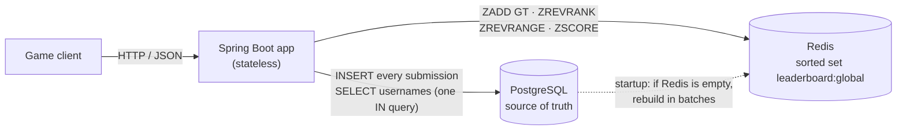

# Leaderboard Service

A backend service for a global game leaderboard. Players submit scores; the service ranks every player by
their **best** score, breaks ties by **who reached that score first**, and answers "top 100", "what's my rank?"
and "who's around me?" in milliseconds.

- **PostgreSQL** is the source of truth: it stores every player and every score submission.
- **Redis** holds the leaderboard as a single sorted set, so every rank query is O(log N + M).
- If Redis loses its data, the service **rebuilds the leaderboard from PostgreSQL** on startup.

Java 21 · Spring Boot 4.1 · PostgreSQL 18 · Redis 8 · Flyway · Testcontainers · k6 · GitHub Actions

See [DESIGN.md](DESIGN.md) for the design decisions and trade-offs.

## Architecture



Submitting a score:

1. Check the player exists, then `INSERT` the submission into PostgreSQL.
2. `ZADD leaderboard:global GT <encoded score> <playerId>` updates Redis only if the new score beats the player's best.
3. `ZSCORE` + `ZREVRANK` return the player's best score and rank.

## Running it

Requirements: Docker. (Java is only needed to run the tests outside Docker.)

```bash
docker compose up --build
```

This starts the app on <http://localhost:8080> with PostgreSQL and Redis. Flyway creates the schema on startup.
Health, including both data stores: <http://localhost:8080/actuator/health>.

### Example requests

```bash
# Create players
curl -s -X POST localhost:8080/api/v1/players -H 'Content-Type: application/json' -d '{"username":"alice"}'
# {"id":"56d1203a-1080-4d5f-b96c-f2e6149e9bdb","username":"alice"}

curl -s -X POST localhost:8080/api/v1/players -H 'Content-Type: application/json' -d '{"username":"bob"}'
# {"id":"41fa1211-15ac-481c-aa26-3794bd97a4f2","username":"bob"}

# Submit scores
curl -s -X POST localhost:8080/api/v1/scores -H 'Content-Type: application/json' \
  -d '{"playerId":"56d1203a-1080-4d5f-b96c-f2e6149e9bdb","score":4200}'
# {"playerId":"56d1203a-1080-4d5f-b96c-f2e6149e9bdb","bestScore":4200,"rank":1}

curl -s -X POST localhost:8080/api/v1/scores -H 'Content-Type: application/json' \
  -d '{"playerId":"41fa1211-15ac-481c-aa26-3794bd97a4f2","score":9000}'

# Top players (limit 1-100, default 100)
curl -s 'localhost:8080/api/v1/leaderboard/top?limit=10'
# [{"rank":1,"playerId":"41fa1211-...","username":"bob","score":9000},
#  {"rank":2,"playerId":"56d1203a-...","username":"alice","score":4200}]

# One player's rank
curl -s localhost:8080/api/v1/leaderboard/players/56d1203a-1080-4d5f-b96c-f2e6149e9bdb
# {"rank":2,"playerId":"56d1203a-...","username":"alice","score":4200}

# The player and up to `range` players above and below (range 1-25, default 5)
curl -s 'localhost:8080/api/v1/leaderboard/players/56d1203a-1080-4d5f-b96c-f2e6149e9bdb/around?range=1'

# Errors are RFC 7807 problem details
curl -s -X POST localhost:8080/api/v1/players -H 'Content-Type: application/json' -d '{"username":"alice"}'
# {"detail":"Username 'alice' is already taken","instance":"/api/v1/players","status":409,"title":"Username taken"}
```

### API

All endpoints are under `/api/v1`.

| Method & path | Success | Errors |
|---|---|---|
| `POST /players` `{"username"}` | `201 {"id","username"}` | 400 invalid username (3–20 chars: letters, digits, `_`), 409 taken |
| `POST /scores` `{"playerId","score"}` | `201 {"playerId","bestScore","rank"}` | 400 invalid body or score outside 0–2,097,151, 404 unknown player |
| `GET /leaderboard/top?limit=100` | `200 [{"rank","playerId","username","score"}]` | 400 limit outside 1–100 |
| `GET /leaderboard/players/{playerId}` | `200 {"rank","playerId","username","score"}` | 404 player has no score |
| `GET /leaderboard/players/{playerId}/around?range=5` | `200 [...]` | 400 range outside 1–25, 404 player has no score |

## Tests

```bash
./mvnw verify
```

This runs the unit tests (JUnit 5 + Mockito) and then the integration tests, which start real PostgreSQL and
Redis containers with Testcontainers. Only Docker needs to be running; no other services.

- **Unit tests** (`*Test`): score encoding and its limits, best-score rules, tie-breaking, the "around" window
  at the edges of the board, write order (PostgreSQL before Redis), and request validation.
- **Integration tests** (`*IT`): every endpoint end to end, including ties, lower scores not changing the rank,
  "around" at the top and bottom of the board, unknown players (404), a check that `GET /top` runs exactly one
  SQL query (no N+1), and the Redis rebuild after `FLUSHALL`.

> **Using Colima instead of Docker Desktop?** Testcontainers doesn't read Docker contexts. Point it at Colima's socket:
> ```bash
> export DOCKER_HOST=unix://$HOME/.colima/default/docker.sock
> export TESTCONTAINERS_DOCKER_SOCKET_OVERRIDE=/var/run/docker.sock
> ```

CI ([.github/workflows/ci.yml](.github/workflows/ci.yml)) runs `./mvnw verify` on every push and pull request.

## Tie-breaking: how scores are encoded in Redis

Redis sorts members of a sorted set by a single number (a 64-bit double). Equal numbers fall back to sorting by
member name, which here is the player id, so it's effectively random. To make "whoever reached the score first ranks
higher" part of Redis's own ordering, the game score and the time it was reached are packed into one number:

```
encoded = score × 2³² + (2³² − 1 − secondsSince2025)
```

- The **high part** is the game score, so a higher score always sorts higher.
- The **low part** is the time, inverted, so an *earlier* time gives a *larger* number. It is always
  below 2³², so it can never carry over into the score part.
- Because the encoded value already includes the time, `ZADD … GT` keeps the right entry. A later submission of an
  equal score encodes *lower*, so it doesn't replace the earlier one.

**Limits.** A double represents every integer up to 2⁵³ exactly; above that, neighbouring values merge and
ordering breaks. So the score and the time must share 53 bits:

| Time precision | Time bits | Supported until | Max score |
|---|---|---|---|
| **1 second (chosen)** | **32** | **2161-02-07** | **2,097,151** |
| 1 second | 30 | 2059-01-10 | 8,388,607 |
| 1 millisecond | 42 | 2164-05-15 | 2,047 |
| 1 millisecond | 37 | 2029-05-10 | 65,535 |

- Scores above **2,097,151** are rejected with a 400.
- Two players reaching the same score **in the same second** tie exactly; Redis then orders them by player id.
- A game with larger scores could give time fewer bits or a coarser precision (e.g. minutes), or keep ties in a
  second structure. See [DESIGN.md](DESIGN.md#5-tie-breaking-and-its-limits).

## Seed data and load test

```bash
docker compose up --build -d
./scripts/seed.sh                 # 100,000 players with random scores (wipes existing data)
docker compose run --rm k6        # 60 s load test, 50 virtual users
```

`seed.sh` inserts players and scores directly into PostgreSQL, deletes the Redis leaderboard and restarts the app,
so the app **rebuilds the leaderboard from PostgreSQL** on startup. On the machine below that rebuild took
**255 ms for 100,000 players** (20 batches of 5,000), as logged by the app.

[`load/leaderboard.js`](load/leaderboard.js) sends ~70% reads (25% top 100, 25% player rank, 20% around ±5) and
~30% score submissions for random seeded players, from 50 virtual users with no pause between requests.

### Results

Measured on 2026-11-09 against the seeded service (100,000 players), after a 20-second warm-up run that is not
counted. Raw output: [`load/results/k6-run.txt`](load/results/k6-run.txt).

| Metric | Result |
|---|---|
| Requests | 340,680 in 60 s |
| **Throughput** | **5,746 requests/s** |
| **p95 latency** | **18.98 ms** |
| **p99 latency** | **28.47 ms** |
| Median latency | 7.48 ms |
| **Error rate** | **0.00%** (0 of 340,680) |

| Endpoint | median | p95 | p99 |
|---|---|---|---|
| `GET /leaderboard/top?limit=100` | 5.56 ms | 16.08 ms | 24.34 ms |
| `GET /leaderboard/players/{id}` | 6.64 ms | 15.90 ms | 24.45 ms |
| `GET /leaderboard/players/{id}/around?range=5` | 8.80 ms | 19.18 ms | 28.35 ms |
| `POST /scores` | 9.99 ms | 22.05 ms | 32.76 ms |

**Machine:** MacBook Pro, Apple M5 (10 cores), 24 GB RAM, macOS 26.6.2. Docker ran in a **Colima VM limited to
2 vCPUs and 4 GiB of RAM**, and the app, PostgreSQL, Redis *and k6 itself* all shared those 2 vCPUs. That makes
these numbers a conservative floor: the load generator competes with the service for CPU. On separate machines,
or with more CPUs given to the app, throughput would be higher.

## Project layout

```
src/main/java/com/example/leaderboard/
  player/        POST /players: entity, repository, service, controller
  score/         POST /scores: stores submissions, updates the leaderboard
  leaderboard/   Redis sorted set, score encoding, read endpoints, startup rebuild
  common/        RFC 7807 error handling, Clock bean
src/main/resources/db/migration/   Flyway SQL migrations
src/test/java/...                  *Test = unit tests, *IT = integration tests (Testcontainers)
scripts/seed.sh                    seed 100,000 players
load/leaderboard.js                k6 load test
```
